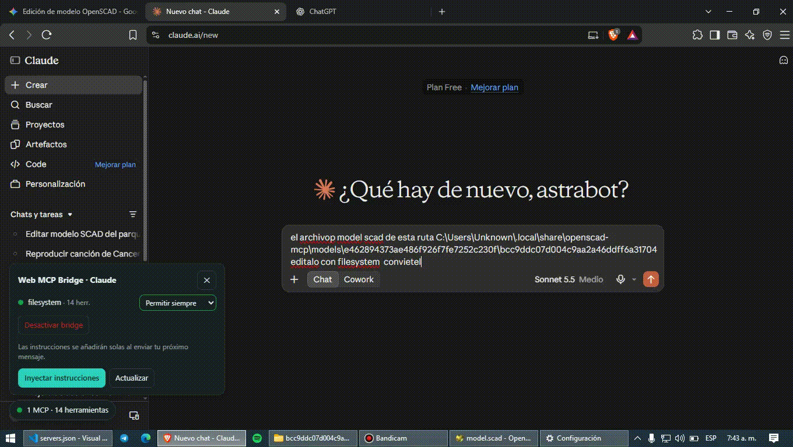
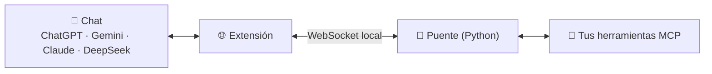
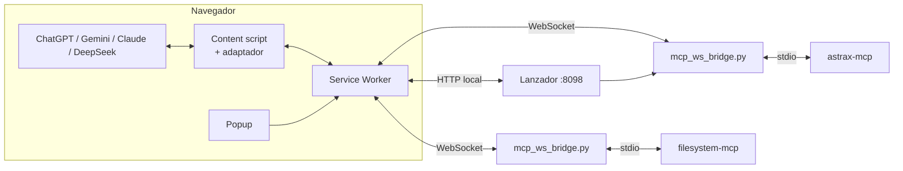

<div align="center">


# Web MCP Bridge

**Usa tus servidores MCP locales con ChatGPT, Gemini, Claude Web y DeepSeek, sin API keys ni suscripciones extra.**

[](README.md)
[](README.es.md)

[](https://github.com/AstraxOf/web-mcp-bridge/actions)


[](https://t.me/AstraxMCP)
[](https://youtube.com/@AstraxOf)
[](https://astrabots.pro)
[](https://github.com/AstraxOf/astrax-mcp)
[](https://github.com/AstraxOf)

</div>

---
<div align="center">
  
</div>

---

> **Web MCP Bridge** le da a ChatGPT, Gemini, Claude y DeepSeek (las versiones web gratuitas) la capacidad de **usar herramientas de tu propio ordenador**: leer archivos, controlar programas, consultar tus datos… sin API keys y sin pagar suscripciones extra. **Tú apruebas cada acción.**

> [!IMPORTANT]
> Solo conecta servidores MCP en los que confíes: una herramienta con acceso al sistema de archivos puede leer lo que le permitas.

**Ir directo a:** [Instalar](#-instalación-paso-a-paso) · [Primer uso](#-tu-primera-vez-60-segundos) · [Añadir mis MCP](#-añade-tus-propios-mcp) · [¿Algo falla?](#-algo-no-funciona)

## 🧩 Cómo funciona (en 20 segundos)

Son **dos piezas** que trabajan juntas:

| Pieza | Qué es | Dónde vive |
|---|---|---|
| 🌐 **La extensión** | Se instala en tu navegador. Lee lo que pide la IA y te muestra los botones y permisos. | Chrome, Edge o Brave |
| 🌉 **El puente** | Un programa pequeño en Python que conecta la extensión con tus herramientas (servidores MCP). | Tu ordenador, en segundo plano |



1. Le pides algo a la IA en el chat.
2. La IA responde con una "orden" (un bloque JSON) pidiendo una herramienta.
3. La extensión te pregunta si la permites → la ejecuta en tu PC → **pega el resultado en el chat** para que la IA siga.

> 🔒 Todo ocurre en tu ordenador. Nada se envía a servidores de terceros.

## ✅ Qué necesitas

| Requisito | Cómo comprobarlo |
|---|---|
| **Chrome, Edge o Brave** (versión 116 o superior) | Menú → *Acerca de*. |
| **Python 3.9 o superior** | Abre una terminal y escribe `python --version`. Si no lo tienes, descárgalo de [python.org/downloads](https://www.python.org/downloads/) y **marca la casilla «Add Python to PATH»** al instalar. |
| **Este proyecto descargado** | Botón verde **Code → Download ZIP** en GitHub y descomprímelo (o `git clone`). **Déjalo en una carpeta fija**: la extensión se carga desde ahí, no lo borres ni lo muevas después. |

Opcional: **Node.js** si vas a usar servidores MCP que se lanzan con `npx` (por ejemplo el de archivos).

## 🚀 Instalación paso a paso

### 🪟 Windows

**Paso 1 · Instala el lanzador (una sola vez)**
Entra en la carpeta `server` y haz **doble clic en `install.cmd`**. Espera a que diga *Listo*.
Esto hace tres cosas por ti: instala lo que falta (`websockets`), hace que el puente **arranque solo cuando inicies sesión** y lo enciende ahora mismo.

**Paso 2 · Carga la extensión en el navegador**
1. Escribe `chrome://extensions` en la barra de direcciones (en Edge: `edge://extensions`).
2. Activa **Modo de desarrollador** (arriba a la derecha).
3. Pulsa **Cargar descomprimida** y elige la carpeta del proyecto (la que contiene el archivo `manifest.json`).
4. Se abrirá solo una **página de bienvenida** que te guía y comprueba cada paso en vivo. Te recomendamos fijar la extensión con el icono del puzle 🧩.

**Paso 3 · Comprueba que está todo en verde**
Abre el icono de la extensión: arriba debe poner **«Puente conectado»** con un punto verde y debajo tus servidores.

¡Listo! Sigue con [Tu primera vez](#-tu-primera-vez-60-segundos).

### 🍎 macOS / 🐧 Linux

```bash
python3 server/install_service.py
```

Instala lo necesario y deja el puente arrancando con tu sesión (launchd en macOS, systemd en Linux). Después carga la extensión igual que en el Paso 2.
Los botones **Iniciar / Apagar** del popup necesitan el *lanzador*, que por ahora está preparado solo para Windows. En macOS/Linux el puente igualmente funciona y se reinicia solo si se cae.

## 🎛️ Controla el puente desde la extensión

No necesitas terminal para el día a día. En el popup, tarjeta **Puente**:

| Botón | Qué hace |
|---|---|
| **Iniciar puente** | Enciende el puente (si estaba apagado). |
| **Apagar puente** | Lo apaga y **se queda apagado** hasta que lo inicies de nuevo (aunque reinicies el PC). |
| **Reiniciar puente** | Lo cierra y lo vuelve a abrir. Úsalo si cambiaste algo o algo se atascó. |
| **Editar servers.json** | Abre el archivo donde se listan tus MCP. Al guardar, se recarga solo. |

> 💡 **Interruptor de arriba vs. «Apagar puente».** El interruptor grande de la cabecera solo hace que la *extensión* deje de actuar (el icono muestra `OFF`). «Apagar puente» cierra el *programa* de tu PC.

Si el botón **Iniciar/Apagar** aparece desactivado, es que falta el lanzador: haz doble clic en `server/install.cmd`.

## 💬 Tu primera vez (60 segundos)

El proyecto trae un **servidor de prueba (`demo`)** para que lo pruebes sin instalar nada más.

1. Abre el popup → pestaña **Servidores** → activa el interruptor de **demo**.
2. Entra en [ChatGPT](https://chatgpt.com), [Gemini](https://gemini.google.com), [Claude](https://claude.ai) o [DeepSeek](https://chat.deepseek.com).
3. Escribe tu mensaje, por ejemplo: **«¿Qué hora es? Usa tus herramientas.»** (las instrucciones se añaden solas al primer mensaje; si no, abre el panel **Web MCP Bridge** abajo a la izquierda y pulsa *Inyectar instrucciones*).
4. La IA pedirá una herramienta → te aparece un aviso → pulsa **Permitir**.
5. El resultado se pega en el chat y la IA te responde. 🎉

> Por defecto el permiso es **«Preguntar siempre»**: nada se ejecuta sin que lo apruebes. Puedes cambiarlo por servidor o para todos a la vez.

## ➕ Añade tus propios MCP

Tus servidores se definen en **`server/servers.json`** (se crea solo en la instalación). Cada uno necesita un **nombre**, un **puerto distinto** y el **comando** que lo arranca:

```json
{
  "servers": [
    { "name": "demo",   "port": 8090, "command": ["python", "server/examples/demo_mcp_server.py"] },
    { "name": "mi-mcp", "port": 8081, "command": ["python", "-m", "mi_servidor_mcp"] },
    { "name": "archivos", "port": 8082, "command": ["npx", "-y", "@modelcontextprotocol/server-filesystem", "C:/Users/tu/Documentos"] }
  ]
}
```

- Más ejemplos en `server/servers.example.json`.
- Pulsa **Editar servers.json** en el popup, guarda y en ~2 segundos aparece en la lista. Actívalo con su interruptor (hasta **5** a la vez; con **1** gastas menos tokens).
- Para desactivar uno sin borrarlo: añade `"disabled": true`.
- En las rutas usa `/` (`C:/Users/...`) en lugar de `\`.

## 🩺 ¿Algo no funciona?

| Síntoma | Solución |
|---|---|
| El popup dice **«Puente apagado»** | Pulsa **Iniciar puente**. Si el botón está desactivado, haz doble clic en `server/install.cmd`. |
| **«Falta el lanzador»** | Es normal la primera vez: ejecuta `server/install.cmd` una vez. |
| `python` no se reconoce | Reinstala Python marcando **Add Python to PATH**, o prueba con `py` en lugar de `python`. |
| **«Puerto ocupado»** (8080, 8090…) | Pulsa **Reiniciar puente**. Si persiste, cambia el `port` de ese servidor en `servers.json`. |
| Un servidor sale **con error** (p. ej. `astrax-mcp`) | Viene de ejemplo: si no lo tienes instalado, bórralo de `servers.json` o ponle `"disabled": true`. |
| Aviso rojo **«servers.json tiene un error»** | Hay una coma o comilla mal puesta. Corrígela y guarda: el puente se recarga solo. |
| El chat no reacciona o no aparece el panel | Recarga la pestaña (F5) y revisa que el interruptor de la cabecera esté activado. Si la web cambió su interfaz, abre un *issue*. |
| Moví o renombré la carpeta del proyecto | Vuelve a ejecutar `server/install.cmd` y pulsa ⟳ en `chrome://extensions`. |
| Quiero quitarlo todo | `python server/install_service.py --uninstall` y quita la extensión. |

¿Sigues atascado? Cuéntalo en el [canal de Telegram](https://t.me/AstraxMCP) o abre un *issue*.

## 🧩 Plataformas compatibles

| Plataforma | Estado | Adaptador |
|---|---|---|
|  | ✅ Soportada | `adapters/chatgpt.js` |
|  | ✅ Soportada | `adapters/gemini.js` |
|  | ✅ Soportada | `adapters/claude.js` |
|  | ✅ Soportada | `adapters/deepseek.js` |
|  ·  | 🗺️ Roadmap | [Contribuir](CONTRIBUTING.md) |

## ✨ Características de un vistazo

| | Habilidad | Qué hace |
|---|---|---|
|  | **Control de contexto** | Registra los servidores que quieras, activa **1 por defecto** (hasta **5**). Solo las herramientas de los activos se describen a la IA; el popup muestra los tokens aproximados. |
|  | **Permisos por MCP** | Selector de 3 estados: *Permitir siempre* (no pregunta nunca) · *Preguntar siempre* (cada llamada aparece con sus argumentos: *Ejecutar*, *Permitir siempre* o *Rechazar*) · *No permitir* (el MCP no se describe a la IA). Global y por servidor, en el popup y en el panel. |
|  | **Nada se omite** | Imágenes, audio y recursos binarios (p. ej. `astrax_ver_pantalla`) se adjuntan al chat como archivos reales; un texto largo se adjunta completo como `.txt`. Si el chat no admite adjuntos, se descarga y el mensaje lo indica. |
|  | **Sin MCP preinstalados** | Añade los tuyos o el servidor demo con un clic. |
|  | **Funciona con la pestaña oculta** | Ningún paso depende de los temporizadores de la página; hay un latido de estado, el envío se comprueba y reintenta, y una llamada atascada no bloquea las siguientes. Último recurso: trae la pestaña al frente un instante (desactivable). |
|  | **La IA no olvida sus herramientas** | Línea corta (~45 tokens) en cada mensaje, reenvío completo cada N mensajes y reenvío automático si la IA dice que no tiene acceso. |
|  | **≈ 50 % menos tokens** | Firmas `nombre(param: tipo)` en lugar de JSON Schema. |
|  | **~40 líneas por plataforma** | Una plataforma nueva son solo selectores. |
|  | **Resistente a cambios de UI** | Varios candidatos por elemento + detección de visibilidad. |
|  | **Blindado** | El puente escucha en `127.0.0.1`, solo acepta orígenes `chrome-extension://` y admite token. Las webs no pueden conectarse a tus herramientas. |
|  | **Sin duplicados y con reconexión** | ID por llamada, línea base al cargar un chat, solo se actúa sobre el último mensaje, backoff exponencial, keep-alive MV3, historial y tema claro/oscuro. |
|  | **JSON mal escapado, sin colgarse** | Si la IA manda rutas de Windows con `\`, saltos de línea reales, comillas sin escapar o comas sobrantes, la extensión **repara el JSON**. Si aun así no se lee, busca las *banderas* `server` / `name` / `arguments` por separado y extrae cada argumento con el schema de la herramienta. Si no hay forma, **avisa a la IA con el motivo exacto** (antes se quedaba esperando). |
|  | **Servidores detectados solos** | La extensión lee `server/servers.json` a través del puerto de control del puente (`http://127.0.0.1:8099/servers`): los MCP nuevos aparecen solos y los que quitas desaparecen. Un servidor que borras a mano no vuelve a aparecer. |
|  | **Adiós al «puerto 8080 ocupado»** | `--restart` / `--stop` / `--status` / `--reload`, recarga en caliente al guardar `servers.json` y reinicio que cierra por sí solo un puente anterior. |
|  | **Reintento sin duplicados** | Si el servidor estaba caído *antes* de enviar la llamada, la extensión espera la reconexión y reintenta. Si la IA manda varias llamadas en un mensaje, se le avisa de que solo se ejecutó la primera. |

## 🧰 Para usuarios avanzados

Todo lo anterior también se puede hacer desde la terminal.

```bash
# Lanzador (Windows): encender, apagar y reiniciar
python server/start_bridge_loop.pyw --ctl start | stop | restart | status | quit

# Puente directo
python server/mcp_ws_bridge.py --config server/servers.json --restart   # reinicia (cierra el anterior aunque ocupe el 8080)
python server/mcp_ws_bridge.py --config server/servers.json --status    # estado de cada servidor
python server/mcp_ws_bridge.py --config server/servers.json --reload    # relee servers.json
python server/mcp_ws_bridge.py --config server/servers.json --stop      # apaga el puente
python server/install_service.py --uninstall                            # quita el arranque automático
```

En Windows también: `server\restart_bridge.cmd` y `server\bridge_status.cmd` (doble clic).

| Puerto | Para qué |
|---|---|
| `8080`, `8081`… | Un puerto por servidor MCP (los defines tú en `servers.json`). |
| `8099` | Control del puente (`/servers`, `/reload`, `/restart`, `/shutdown`). |
| `8098` | Lanzador (`/start`, `/stop`, `/restart`, `/status`). Configurable con `"launcher_port"`. |

- Si ya hay un puente corriendo, `--config` lo **recarga** en lugar de fallar con «puerto ocupado».
- `--restart` solo cierra procesos que sean un `mcp_ws_bridge`; si otro programa usa el puerto, te dice cuál y no lo toca.
- `servers.json` admite BOM (el que añade PowerShell), `"control_port"`, `"launcher_port"` y `"disabled": true` por servidor.
- Un solo servidor sin archivo de configuración: `python server/mcp_ws_bridge.py --port 8080 --name demo -- python server/examples/demo_mcp_server.py`

### Arquitectura



## 📡 Protocolo de llamada

La IA responde con un único bloque y se detiene:

````json
{
  "mcp_call": {
    "server": "nombre_del_servidor_mcp",
    "name": "nombre_de_la_herramienta",
    "arguments": { "arg1": "valor" }
  }
}
````

El resultado vuelve como mensaje del usuario:

```
[MCP_RESULT server="demo" tool="sumar" status="ok"]
42
[/MCP_RESULT]
```

`status` puede ser `ok`, `error` o `rejected`.

> [!NOTE]
> El contenido de `MCP_RESULT` se presenta a la IA como *datos*, no como instrucciones (mitigación de *prompt injection*).

### Formatos tolerantes y avisos de error

El parser lee la llamada en tres capas: **1)** JSON estricto, **2)** JSON reparado (rutas con `\`, saltos de línea reales, comillas sin escapar, comillas tipográficas, comas finales) y **3)** *banderas*: busca por separado `server`, `name` y `arguments` y extrae cada argumento por su nombre usando el schema de la herramienta. Solo se acepta si el servidor y la herramienta existen entre los MCP activos y el mensaje no está cortado.

Si hay intención de llamada pero no se puede leer, la extensión responde a la IA (máx. 3 avisos seguidos) y no se queda esperando:

```
[MCP_RESULT server="bridge" tool="mcp_call" status="format_error"]
No se ejecuto nada: tu bloque mcp_call no se pudo leer. Motivo: secuencia de escape invalida (... cerca de: ...)
[/MCP_RESULT]
```

> [!NOTE]
> Una ruta como `C:\new\test` es ambigua para cualquier JSON (`\n`, `\t`): por eso el prompt pide siempre rutas con `/`.

## 📁 Estructura

```
manifest.json
background/      background.js (service worker) · ws_client.js (conexión MCP + reconexión)
popup/           popup.html · popup.js · popup.css
welcome/         asistente de primer arranque (se abre al instalar)
content_scripts/ core_bridge.js · prompt_builder.js · ui_widget.js · utils.js · mcp_parser.js
  adapters/      base_adapter.js · chatgpt.js · gemini.js · claude.js · deepseek.js
server/          mcp_ws_bridge.py (puente) · start_bridge_loop.pyw (lanzador) · install.cmd · install_service.py
                 restart_bridge.cmd · servers.example.json · examples/demo_mcp_server.py
tests/ scripts/  pruebas, validador, generador de iconos y empaquetado
```

## 🔧 Si una web cambia su interfaz

Los selectores viven al principio de cada adaptador (`content_scripts/adapters/*.js`). Añade el nuevo
selector **al inicio** de la lista correspondiente (`composer`, `sendButton`, `assistantMessages`, `stopButton`).
Abre un issue con la plantilla «Selector roto»: suele resolverse con una línea.

## 🔒 Modelo de seguridad

| Riesgo | Mitigación |
|---|---|
| Una web abre `ws://localhost` y ejecuta herramientas | El puente rechaza cualquier `Origin` que no sea de una extensión |
| La IA ejecuta acciones no deseadas | Permiso «Preguntar siempre» por defecto; «Permitir siempre» es una decisión explícita por MCP (o global) y «No permitir» bloquea el MCP |
| Instrucciones ocultas en resultados (*prompt injection*) | El prompt indica que `MCP_RESULT` es solo datos; tú ves cada llamada antes de ejecutarla |
| Exposición en red | Escucha solo en `127.0.0.1`; token opcional (`--token`) |
| Una web lee o apaga el puerto de control (`:8099`) | Solo acepta `Origin` de extensiones; `/reload` y `/shutdown` exigen POST; escucha solo en `127.0.0.1`; `--restart` únicamente cierra procesos `mcp_ws_bridge` |

## 🧪 Desarrollo

```bash
npm test        # sintaxis, parser, prompt y prueba de integración del puente
npm run pack    # genera dist/web-mcp-bridge.zip
```

## 🗺️ Roadmap

- [ ] Soporte para Firefox (MV3) y Perplexity / Mistral Le Chat
- [ ] Llamadas múltiples por mensaje
- [ ] Selectores configurables desde el popup
- [ ] Transporte SSE / Streamable HTTP además de WebSocket
- [ ] Publicación en Chrome Web Store

## 🤝 Comunidad y contribuciones

**Astrax** es Open Source y crece con la comunidad. Si quieres sumarte, eres bienvenido: puedes abrir issues, enviar pull requests, proponer ideas, probar Astrax en otros sistemas o clientes MCP y reportar errores. Lee [CONTRIBUTING.md](CONTRIBUTING.md): los adaptadores nuevos son la mejor forma de empezar.

Antes de participar, lee también nuestro [Código de Conducta](CODE_OF_CONDUCT.md) y reporta los problemas de seguridad de forma privada siguiendo la [Política de seguridad](SECURITY.md) (nunca en un issue público).

[](https://t.me/AstraxMCP)
[](https://youtube.com/@AstraxOf)
[](https://t.me/RufusOficial)
[](mailto:avpn497@gmail.com)

> [!TIP]
> **¿Buscas más servidores MCP para conectar al puente?** Explora la lista curada por la comunidad [Awesome MCP Servers](https://github.com/punkpeye/awesome-mcp-servers).

<div align="center">

[](https://github.com/punkpeye/awesome-mcp-servers)

</div>

Si te sirvió el proyecto, deja una ⭐ en el repositorio y suscríbete al canal.

<div align="center">

Hecho con 💙 por Rufus · [@AstraxOf](https://github.com/AstraxOf) · [astrabots.pro](https://astrabots.pro)

**[Licencia MIT](LICENSE)**

</div>