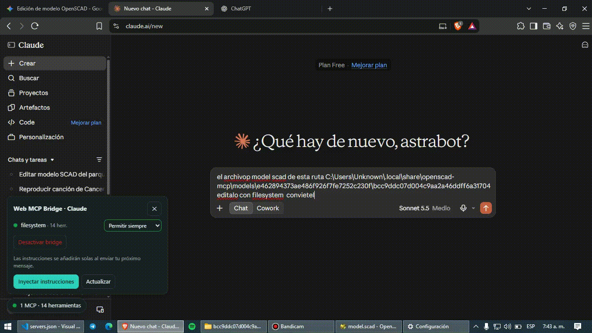
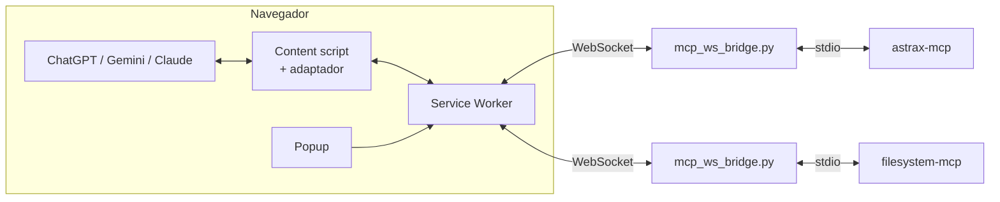

<div align="center">


# Web MCP Bridge

**Usa tus servidores MCP locales con ChatGPT, Gemini y Claude Web, sin API keys ni suscripciones extra.**

[](README.md)
[](README.es.md)

[](https://github.com/AstraxOf/web-mcp-bridge/actions)


[](https://t.me/AstraxMCP)
[](https://youtube.com/@AstraxOf)
[](https://astrabots.pro)
[](https://github.com/AstraxOf/astrax-mcp)
[](https://github.com/AstraxOf)

</div>

---
<div align="center">
  
</div>

Las interfaces web gratuitas de IA no hablan MCP. **Web MCP Bridge** les añade esa capacidad:
la IA pide una herramienta con un bloque JSON, la extensión la ejecuta en tu servidor MCP local
y devuelve el resultado al chat. Tú decides qué se ejecuta.

> [!IMPORTANT]
> Solo conecta servidores MCP en los que confíes: una herramienta con acceso al sistema de archivos puede leer lo que le permitas.



## 🧩 Plataformas compatibles

| Plataforma | Estado | Adaptador |
|---|---|---|
|  | ✅ Soportada | `adapters/chatgpt.js` |
|  | ✅ Soportada | `adapters/gemini.js` |
|  | ✅ Soportada | `adapters/claude.js` |
|  ·  ·  | 🗺️ Roadmap | [Contribuir](CONTRIBUTING.md) |

## ✨ Características de un vistazo

| | Habilidad | Qué hace |
|---|---|---|
|  | **Control de contexto** | Registra los servidores que quieras, activa **1 por defecto** (hasta **5**). Solo las herramientas de los activos se describen a la IA; el popup muestra los tokens aproximados. |
|  | **Permisos por MCP** | Selector de 3 estados: *Permitir siempre* (no pregunta nunca) · *Preguntar siempre* (cada llamada aparece con sus argumentos: *Ejecutar*, *Permitir siempre* o *Rechazar*) · *No permitir* (el MCP no se describe a la IA). Global y por servidor, en el popup y en el panel. |
|  | **Nada se omite** | Imágenes, audio y recursos binarios (p. ej. `astrax_ver_pantalla`) se adjuntan al chat como archivos reales; un texto largo se adjunta completo como `.txt`. Si el chat no admite adjuntos, se descarga y el mensaje lo indica. |
|  | **Sin MCP preinstalados** | Añade los tuyos o el servidor demo con un clic. |
|  | **Funciona con la pestaña oculta** | Ningún paso depende de los temporizadores de la página; hay un latido de estado, el envío se comprueba y reintenta, y una llamada atascada no bloquea las siguientes. Último recurso: trae la pestaña al frente un instante (desactivable). |
|  | **La IA no olvida sus herramientas** | Línea corta (~45 tokens) en cada mensaje, reenvío completo cada N mensajes y reenvío automático si la IA dice que no tiene acceso. |
|  | **≈ 50 % menos tokens** | Firmas `nombre(param: tipo)` en lugar de JSON Schema. |
|  | **~40 líneas por plataforma** | Una plataforma nueva son solo selectores. |
|  | **Resistente a cambios de UI** | Varios candidatos por elemento + detección de visibilidad. |
|  | **Blindado** | El puente escucha en `127.0.0.1`, solo acepta orígenes `chrome-extension://` y admite token. Las webs no pueden conectarse a tus herramientas. |
|  | **Sin duplicados y con reconexión** | ID por llamada, línea base al cargar un chat, solo se actúa sobre el último mensaje, backoff exponencial, keep-alive MV3, historial y tema claro/oscuro. |

> [!TIP]
> ¿Quieres probarlo en 60 segundos? Incluye un **servidor MCP de demostración**. Ve a [Prueba en 60 segundos](#-prueba-en-60-segundos).

## ⚡ Instalación en 2 pasos (y después solo un botón)

Los navegadores no pueden lanzar programas de tu equipo, así que hace falta **una sola vez** este comando.
Deja el puente corriendo en segundo plano y arrancando solo con tu sesión (Windows, macOS y Linux):

```bash
python server/install_service.py
```

Luego carga la extensión (`chrome://extensions` → Modo desarrollador → *Cargar descomprimida*).
Desde ese momento todo se controla con el **interruptor del popup** (o el botón *Desactivar bridge* del panel dentro del chat).
Con el bridge apagado no hay conexiones, no se inyecta nada y el icono muestra `OFF`.
Para quitar el arranque automático: `python server/install_service.py --uninstall`.

## 🚀 Prueba en 60 segundos

```bash
pip install -r server/requirements.txt
python server/mcp_ws_bridge.py --port 8080 --name demo -- python server/examples/demo_mcp_server.py
```

1. Abre `chrome://extensions` → activa **Modo desarrollador** → **Cargar descomprimida** → elige esta carpeta.
2. Abre el popup y añade tu servidor (nombre `astrax_mcp`, dirección `ws://localhost:8080`); se pone en verde al conectar. Para probar sin nada propio, usa *Añadir servidor de prueba (demo)*.
3. Entra en ChatGPT, Gemini o Claude, abre el panel **Web MCP Bridge** (abajo a la izquierda) y pulsa **Inyectar instrucciones**.
4. Escribe: *«¿Qué hora es? Usa tus herramientas.»* → aprueba la llamada → listo.

### Con tu propio MCP (por ejemplo `astrax-mcp`)

```bash
python server/mcp_ws_bridge.py --port 8080 --name astrax -- python -m astrax_mcp
```

Varios a la vez: copia `server/servers.example.json` a `servers.json` y ejecuta
`python server/mcp_ws_bridge.py --config servers.json`. Después regístralos en el popup.

## 📡 Protocolo de llamada

La IA responde con un único bloque y se detiene:

````json
{
  "mcp_call": {
    "server": "nombre_del_servidor_mcp",
    "name": "nombre_de_la_herramienta",
    "arguments": { "arg1": "valor" }
  }
}
````

El resultado vuelve como mensaje del usuario:

```
[MCP_RESULT server="demo" tool="sumar" status="ok"]
42
[/MCP_RESULT]
```

`status` puede ser `ok`, `error` o `rejected`.

> [!NOTE]
> El contenido de `MCP_RESULT` se presenta a la IA como *datos*, no como instrucciones (mitigación de *prompt injection*).

## 📁 Estructura

```
manifest.json
background/      background.js (service worker) · ws_client.js (conexión MCP + reconexión)
popup/           popup.html · popup.js · popup.css
content_scripts/ core_bridge.js · prompt_builder.js · ui_widget.js · utils.js
  adapters/      base_adapter.js · chatgpt.js · gemini.js · claude.js
server/          mcp_ws_bridge.py · examples/demo_mcp_server.py · servers.example.json
tests/ scripts/  pruebas, validador, generador de iconos y empaquetado
```

## 🔧 Si una web cambia su interfaz

Los selectores viven al principio de cada adaptador (`content_scripts/adapters/*.js`). Añade el nuevo
selector **al inicio** de la lista correspondiente (`composer`, `sendButton`, `assistantMessages`, `stopButton`).
Abre un issue con la plantilla «Selector roto»: suele resolverse con una línea.

## 🔒 Modelo de seguridad

| Riesgo | Mitigación |
|---|---|
| Una web abre `ws://localhost` y ejecuta herramientas | El puente rechaza cualquier `Origin` que no sea de una extensión |
| La IA ejecuta acciones no deseadas | Permiso «Preguntar siempre» por defecto; «Permitir siempre» es una decisión explícita por MCP (o global) y «No permitir» bloquea el MCP |
| Instrucciones ocultas en resultados (*prompt injection*) | El prompt indica que `MCP_RESULT` es solo datos; tú ves cada llamada antes de ejecutarla |
| Exposición en red | Escucha solo en `127.0.0.1`; token opcional (`--token`) |

## 🧪 Desarrollo

```bash
npm test        # sintaxis, parser, prompt y prueba de integración del puente
npm run pack    # genera dist/web-mcp-bridge.zip
```

## 🗺️ Roadmap

- [ ] Soporte para Firefox (MV3) y Perplexity / DeepSeek / Mistral Le Chat
- [ ] Llamadas múltiples por mensaje
- [ ] Selectores configurables desde el popup
- [ ] Transporte SSE / Streamable HTTP además de WebSocket
- [ ] Publicación en Chrome Web Store

## 🤝 Comunidad y contribuciones

**Astrax** es Open Source y crece con la comunidad. Si quieres sumarte, eres bienvenido: puedes abrir issues, enviar pull requests, proponer ideas, probar Astrax en otros sistemas o clientes MCP y reportar errores. Lee [CONTRIBUTING.md](CONTRIBUTING.md): los adaptadores nuevos son la mejor forma de empezar.

[](https://t.me/AstraxMCP)
[](https://youtube.com/@AstraxOf)
[](https://t.me/RufusOficial)
[](mailto:avpn497@gmail.com)

Si te sirvió el proyecto, deja una ⭐ en el repositorio y suscríbete al canal.

<div align="center">

Hecho con 💙 por Rufus · [@AstraxOf](https://github.com/AstraxOf) · [astrabots.pro](https://astrabots.pro)

**[Licencia MIT](LICENSE)**

</div>
