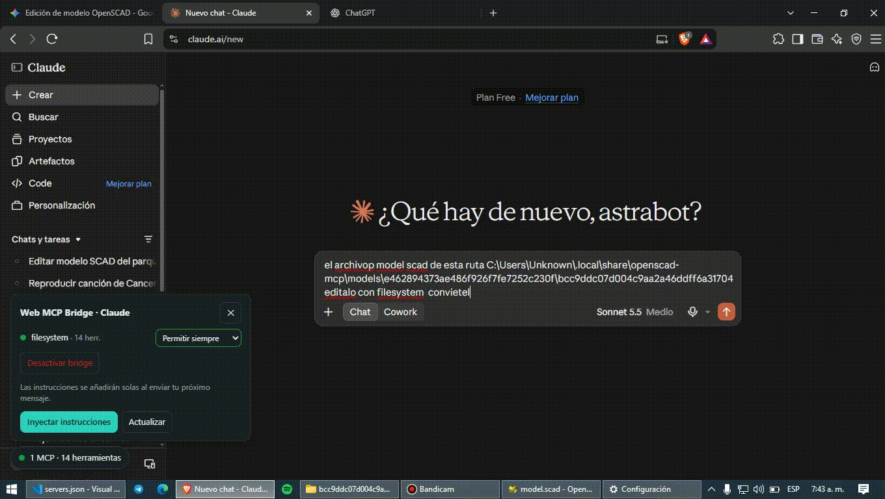
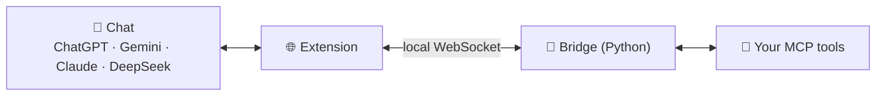

<div align="center">


# Web MCP Bridge

**Use your local MCP servers with ChatGPT, Gemini, Claude Web and DeepSeek: no API keys, no extra subscriptions.**

[](README.md)
[](README.es.md)

[](https://github.com/AstraxOf/web-mcp-bridge/actions)


[](https://t.me/AstraxMCP)
[](https://youtube.com/@AstraxOf)
[](https://astrabots.pro)
[](https://github.com/AstraxOf/astrax-mcp)
[](https://github.com/AstraxOf)

</div>

---
<div align="center">
  
</div>

---

> **Web MCP Bridge** lets the free web versions of ChatGPT, Gemini, Claude and DeepSeek **use tools on your own computer**: read files, control programs, query your data… with no API keys and no extra subscriptions. **You approve every action.**

> [!IMPORTANT]
> Only connect MCP servers you trust. A tool with filesystem access can read whatever you allow it to.

**Jump to:** [Install](#-step-by-step-installation) · [First use](#-your-first-time-60-seconds) · [Add my MCPs](#-add-your-own-mcp-servers) · [Troubleshooting](#-something-not-working)

## 🧩 How it works (in 20 seconds)

Two pieces work together:

| Piece | What it is | Where it lives |
|---|---|---|
| 🌐 **The extension** | Installed in your browser. It reads what the AI asks for and shows you the buttons and permissions. | Chrome, Edge or Brave |
| 🌉 **The bridge** | A small Python program that connects the extension to your tools (MCP servers). | Your computer, in the background |



1. You ask the AI something in the chat.
2. The AI answers with an "order" (a JSON block) asking for a tool.
3. The extension asks if you allow it → runs it on your PC → **pastes the result back into the chat** so the AI can continue.

> 🔒 Everything happens on your computer. Nothing is sent to third-party servers.

## ✅ What you need

| Requirement | How to check |
|---|---|
| **Chrome, Edge or Brave** (version 116 or newer) | Menu → *About*. |
| **Python 3.9 or newer** | Open a terminal and type `python --version`. If missing, get it from [python.org/downloads](https://www.python.org/downloads/) and **tick “Add Python to PATH”** during setup. |
| **This project downloaded** | Green **Code → Download ZIP** button on GitHub, then unzip (or `git clone`). **Keep it in a permanent folder**: the extension loads from there, so don't delete or move it afterwards. |

Optional: **Node.js**, if you'll use MCP servers launched with `npx` (for example the filesystem one).

## 🚀 Step-by-step installation

### 🪟 Windows

**Step 1 · Install the launcher (once)**
Open the `server` folder and **double-click `install.cmd`**. Wait until it says *Done*.
It does three things for you: installs what's missing (`websockets`), makes the bridge **start automatically when you log in**, and starts it right now.

**Step 2 · Load the extension in your browser**
1. Type `chrome://extensions` in the address bar (Edge: `edge://extensions`).
2. Turn on **Developer mode** (top right).
3. Click **Load unpacked** and pick the project folder (the one containing `manifest.json`).
4. A **welcome page** opens by itself, guides you and checks each step live. We recommend pinning the extension with the puzzle icon 🧩.

**Step 3 · Check everything is green**
Open the extension icon: the top should say **“Puente conectado”** (bridge connected) with a green dot and your servers below.

Done! Continue with [Your first time](#-your-first-time-60-seconds).

### 🍎 macOS / 🐧 Linux

```bash
python3 server/install_service.py
```

It installs what's needed and makes the bridge start with your session (launchd on macOS, systemd on Linux). Then load the extension as in Step 2.
The popup's **Start / Stop** buttons need the *launcher*, which is currently Windows-only. On macOS/Linux the bridge still works and restarts itself if it crashes.

## 🎛️ Control the bridge from the extension

No terminal needed for everyday use. In the popup, **bridge** card:

| Button | What it does |
|---|---|
| **Start** | Turns the bridge on (if it was off). |
| **Stop** | Turns it off and **keeps it off** until you start it again (even after rebooting your PC). |
| **Restart** | Closes and reopens it. Use it after changing something or if it got stuck. |
| **Edit servers.json** | Opens the file that lists your MCPs. It reloads by itself when you save. |

> 💡 **Header switch vs. “Stop”.** The big switch in the header only makes the *extension* stop acting (the icon shows `OFF`). “Stop” closes the *program* on your PC.

If **Start/Stop** is greyed out, the launcher is missing: double-click `server/install.cmd`.

## 💬 Your first time (60 seconds)

The project ships with a **demo server (`demo`)** so you can try it without installing anything else.

1. Open the popup → **Servers** tab → turn on the **demo** switch.
2. Go to [ChatGPT](https://chatgpt.com), [Gemini](https://gemini.google.com), [Claude](https://claude.ai) or [DeepSeek](https://chat.deepseek.com).
3. Type something like: **“What time is it? Use your tools.”** (the instructions are added automatically to your first message; if not, open the **Web MCP Bridge** panel at the bottom-left and click *Inject instructions*).
4. The AI asks for a tool → a prompt appears → click **Allow**.
5. The result is pasted into the chat and the AI answers you. 🎉

> By default permission is **“Ask every time”**: nothing runs unless you approve it. You can change it per server or for all of them.

## ➕ Add your own MCP servers

Your servers are defined in **`server/servers.json`** (created automatically on install). Each one needs a **name**, a **unique port** and the **command** that starts it:

```json
{
  "servers": [
    { "name": "demo",  "port": 8090, "command": ["python", "server/examples/demo_mcp_server.py"] },
    { "name": "my-mcp", "port": 8081, "command": ["python", "-m", "my_mcp_server"] },
    { "name": "files", "port": 8082, "command": ["npx", "-y", "@modelcontextprotocol/server-filesystem", "C:/Users/you/Documents"] }
  ]
}
```

- More examples in `server/servers.example.json`.
- Click **Edit servers.json** in the popup, save, and within ~2 seconds it shows up in the list. Turn it on with its switch (up to **5** at once; **1** costs fewer tokens).
- To disable one without deleting it: add `"disabled": true`.
- In paths use `/` (`C:/Users/...`) instead of `\`.

## 🩺 Something not working?

| Symptom | Fix |
|---|---|
| Popup says **“Puente apagado”** (bridge off) | Click **Start**. If the button is greyed out, double-click `server/install.cmd`. |
| **“Falta el lanzador”** (launcher missing) | Normal the first time: run `server/install.cmd` once. |
| `python` is not recognized | Reinstall Python ticking **Add Python to PATH**, or try `py` instead of `python`. |
| **“Port in use”** (8080, 8090…) | Click **Restart**. If it persists, change that server's `port` in `servers.json`. |
| A server shows **an error** (e.g. `astrax-mcp`) | It's just an example: if you don't have it installed, delete it from `servers.json` or add `"disabled": true`. |
| Red notice **“servers.json tiene un error”** | A comma or quote is misplaced. Fix it and save: the bridge reloads by itself. |
| The chat doesn't react / panel missing | Reload the tab (F5) and make sure the header switch is on. If the site changed its UI, open an issue. |
| I moved or renamed the project folder | Run `server/install.cmd` again and click ⟳ in `chrome://extensions`. |
| I want to remove everything | `python server/install_service.py --uninstall` and remove the extension. |

Still stuck? Tell us in the [Telegram channel](https://t.me/AstraxMCP) or open an issue.

## 🧩 Supported platforms

| Platform | Status | Adapter |
|---|---|---|
|  | ✅ Supported | `adapters/chatgpt.js` |
|  | ✅ Supported | `adapters/gemini.js` |
|  | ✅ Supported | `adapters/claude.js` |
|  | ✅ Supported | `adapters/deepseek.js` |
|  ·  | 🗺️ Roadmap | [Contribute](CONTRIBUTING.md) |

## ✨ Skills at a glance

| | Skill | What it does |
|---|---|---|
|  | **Context control** | Register many servers, **1 active by default** (up to **5**). Only active servers' tools reach the model; the popup shows the approximate token cost. |
|  | **Per-MCP permissions** | 3-state selector — *Allow always* · *Ask every time* · *Don't allow* — global and per server, in the popup and the in-page panel. |
|  | **Nothing is dropped** | Images, audio and binary resources are attached to the chat as real files; long text is attached in full instead of truncated. |
|  | **No preinstalled MCP** | Add your own, or the bundled demo server with one click. |
|  | **Reliable in the background** | No step relies on page timers (throttled when hidden); delivery is verified and retried. |
|  | **The AI doesn't forget** | A one-line reminder per message plus periodic full re-injection. |
|  | **≈ 50 % fewer tokens** | Tools are described as `name(param: type)` signatures instead of JSON Schema. |
|  | **~40 lines per platform** | A new platform is just a set of selectors. |
|  | **Locked down** | The Python bridge listens on `127.0.0.1`, only accepts `chrome-extension://` origins and supports a token. Websites can't reach your tools. |
|  | **No duplicates, auto-reconnect** | Per-call IDs, exponential backoff, keep-alive for the MV3 Service Worker, call history, light/dark UI. |
|  | **Badly escaped JSON never hangs the chat** | Windows paths with `\`, raw newlines, unescaped quotes or trailing commas are **repaired**. If it still can't be read, the `server` / `name` / `arguments` *flags* are found separately and each argument is extracted using the tool schema. If nothing works, the AI **is told the exact reason** instead of waiting forever. |
|  | **Servers detected automatically** | The extension reads `server/servers.json` through the bridge's control port (`http://127.0.0.1:8099/servers`): new MCPs show up on their own and removed ones disappear. A server you delete by hand stays deleted. |
|  | **No more "port 8080 in use"** | `--restart` / `--stop` / `--status` / `--reload`, hot reload when `servers.json` is saved, and a restart that closes a previous bridge by itself. |
|  | **Reconnect without duplicates** | If the server was down *before* the call was sent, the extension waits for the reconnection and retries. If the AI sends several calls in one message, it's told only the first one ran. |

## 🧰 For advanced users

Everything above can also be done from the terminal.

```bash
# Launcher (Windows): start, stop and restart
python server/start_bridge_loop.pyw --ctl start | stop | restart | status | quit

# Bridge directly
python server/mcp_ws_bridge.py --config server/servers.json --restart   # restart (closes the old one even if it holds :8080)
python server/mcp_ws_bridge.py --config server/servers.json --status    # status of every server
python server/mcp_ws_bridge.py --config server/servers.json --reload    # re-read servers.json
python server/mcp_ws_bridge.py --config server/servers.json --stop      # stop the bridge
python server/install_service.py --uninstall                            # remove auto-start
```

On Windows you can also double-click `server\restart_bridge.cmd` / `server\bridge_status.cmd`.

| Port | Purpose |
|---|---|
| `8080`, `8081`… | One port per MCP server (you define them in `servers.json`). |
| `8099` | Bridge control (`/servers`, `/reload`, `/restart`, `/shutdown`). |
| `8098` | Launcher (`/start`, `/stop`, `/restart`, `/status`). Configurable with `"launcher_port"`. |

- If a bridge is already running, `--config` **reloads** it instead of failing with "port in use".
- `--restart` only closes `mcp_ws_bridge` processes; if another program owns the port it tells you which and leaves it alone.
- `servers.json` accepts a BOM (added by PowerShell), a top-level `"control_port"` / `"launcher_port"` and `"disabled": true` per server.
- A single server without a config file: `python server/mcp_ws_bridge.py --port 8080 --name demo -- python server/examples/demo_mcp_server.py`

## 📡 Call protocol

```json
{ "mcp_call": { "server": "server_name", "name": "tool_name", "arguments": { "arg1": "value" } } }
```

Results come back as:

```
[MCP_RESULT server="…" tool="…" status="ok|error|rejected"]
…
[/MCP_RESULT]
```

> [!NOTE]
> The content of `MCP_RESULT` is presented to the AI as *data*, not instructions (prompt-injection mitigation).

### Tolerant formats and error feedback

The parser reads the call in three layers: **1)** strict JSON, **2)** repaired JSON (backslash paths, raw newlines, unescaped or typographic quotes, trailing commas) and **3)** *flags*: `server`, `name` and `arguments` are located separately and each argument is extracted by name using the tool schema. A call is only accepted if the server and tool exist among the active MCPs and the message isn't cut off.

If the AI clearly tried to call a tool but the block can't be read, the extension answers (max. 3 consecutive notices) instead of leaving the chat waiting:

```
[MCP_RESULT server="bridge" tool="mcp_call" status="format_error"]
Nothing was executed: your mcp_call block could not be read. Reason: invalid escape sequence (... near: ...)
[/MCP_RESULT]
```

> [!NOTE]
> A path such as `C:\new\test` is ambiguous for any JSON parser (`\n`, `\t`), which is why the prompt always asks for `/` in paths.

## 🔐 Security model

| Risk | Mitigation |
|---|---|
| A website opens `ws://localhost` and runs tools | The bridge rejects any `Origin` that isn't a browser extension. |
| The AI runs unwanted actions | “Ask every time” is the default; “Allow always” is an explicit choice per MCP (or global); “Don't allow” blocks the MCP. |
| Hidden instructions in results (*prompt injection*) | The prompt marks `MCP_RESULT` as data only, and you see each call before it runs. |
| Network exposure | Listens on `127.0.0.1` only; optional token (`--token`). |
| A website reads or shuts down the control (`:8099`) or launcher (`:8098`) ports | They only accept extension `Origin`s and local `Host`s; state-changing routes require POST; `--restart` only closes real bridge processes. |

## 🛠️ If a website changes its interface

Selectors live at the top of each adapter (`content_scripts/adapters/*.js`). Add the new selector **at the start** of the matching list (`composer`, `sendButton`, `assistantMessages`, `stopButton`) and open an issue: it's usually a one-line fix.

## 🛠️ Development

```bash
npm test      # syntax, parser, prompt builder and bridge integration tests
npm run pack  # dist/web-mcp-bridge.zip
```

## 🤝 Community & Contributing

**Astrax** is open source and grows with its community. You're welcome to open issues, send pull requests, suggest ideas, try Astrax on other systems or MCP clients, and report bugs. Read [CONTRIBUTING.md](CONTRIBUTING.md) to get started — new adapters are the best first contribution.

Please also read our [Code of Conduct](CODE_OF_CONDUCT.md) before taking part, and report security issues privately by following our [Security Policy](SECURITY.md) (never in a public issue).

[](https://t.me/AstraxMCP)
[](https://youtube.com/@AstraxOf)
[](https://t.me/RufusOficial)
[](mailto:avpn497@gmail.com)

> [!TIP]
> **Looking for more MCP servers to plug into the bridge?** Browse the community-curated [Awesome MCP Servers](https://github.com/punkpeye/awesome-mcp-servers) list.

<div align="center">

[](https://github.com/punkpeye/awesome-mcp-servers)

</div>

If you find the project useful, leave a ⭐ on the repository and subscribe to the channel.

<div align="center">

Made with 💙 by Rufus · [@AstraxOf](https://github.com/AstraxOf) · [astrabots.pro](https://astrabots.pro)

**[MIT License](LICENSE)**

</div>
